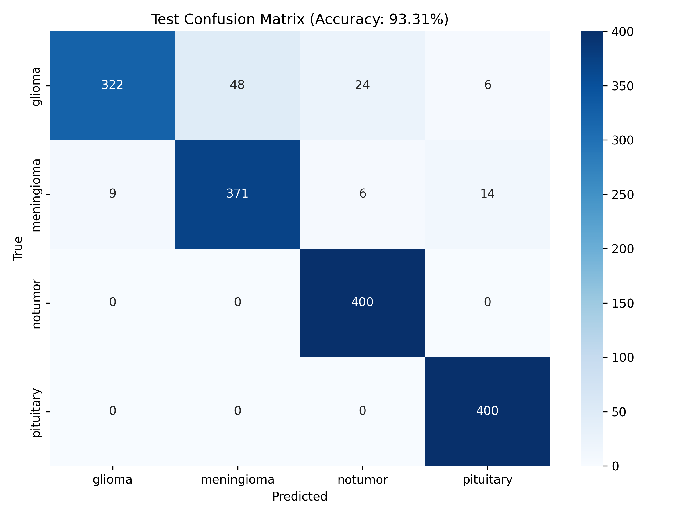

# 🧠 Brain Tumor Detection & Diagnostic AI Assistant

An end-to-end Multimodal Deep Learning & AI system for Brain Tumor MRI scan classification and medical report translation, optimized for Apple Silicon (M-series GPU) and clinical interpretability.

---

## 🌟 Key Highlights

- **93.31% Test Accuracy**: Evaluated on 1,600 unseen MRI test scans with balanced generalization across all classes.
- **100% Normal Brain Detection Recall**: Zero false alarms on healthy brain scans (`notumor` class recall: 100%).
- **100% Pituitary Tumor Recall**: Accurate identification of pituitary masses.
- **Explainable AI (Grad-CAM)**: High-resolution Class Activation Maps highlighting the exact tumor regions that influenced the model's decision.
- **Multimodal AI Medical Translator**: Dual-mode LLM assistant (Cloud Groq Llama 3.3 or Local Ollama Gemma 4) that converts complex radiology PDF reports into plain, compassionate patient summaries.

---

## 📊 Dataset & Sourcing

- **Source**: [Masoud Nickparvar Brain Tumor MRI Dataset](https://www.kaggle.com/datasets/masoudnickparvar/brain-tumor-mri-dataset) via `kagglehub`
- **Total Images**: 7,023 MRI scans across 4 balanced categories:
  - `glioma`: 1,621 images
  - `meningioma`: 1,645 images
  - `notumor`: 2,000 images
  - `pituitary`: 1,757 images
- **Train / Test Split**: 5,423 Training / 1,600 Testing images (exactly 400 per class in the test benchmark).

---

## 🔬 Model Performance & Benchmark

### Classification Report (1,600 Unseen Test Scans)

| Class | Precision | Recall | F1-Score | Support |
| :--- | :---: | :---: | :---: | :---: |
| **Glioma** | **97.28%** | 80.50% | 88.10% | 400 |
| **Meningioma** | **88.54%** | **92.75%** | **90.60%** | 400 |
| **No Tumor** | **93.02%** | **100.00%** | **96.39%** | 400 |
| **Pituitary** | **95.24%** | **100.00%** | **97.56%** | 400 |
| **Overall Accuracy** | — | — | **93.31%** | **1,600** |
| **Macro Average** | **93.52%** | **93.31%** | **93.16%** | **1,600** |



---

## 🛠️ Architecture & Training Strategy

1. **Backbone**: EfficientNetB0 pre-trained on ImageNet.
2. **Input Representation**: Raw `[0, 255]` pixel inputs preserving internal EfficientNet normalization.
3. **Data Pipeline**: `tf.keras.utils.image_dataset_from_directory` with `AUTOTUNE` prefetching and gentle augmentation (`RandomFlip`, `RandomRotation(0.05)`, `RandomZoom(0.05)`).
4. **Regularization**: L2 weight decay (`1e-4`) on the dense classification head + `Dropout(0.35)` to prevent overfitting.
5. **Two-Stage Fine-Tuning**:
   - **Phase 1**: Warm-up of the dense head with Adam (`lr=1e-3`).
   - **Phase 2**: Unfreezing the top 50 layers with Adam (`lr=1e-4` down to `1e-7` via `ReduceLROnPlateau`).

---

## 🚀 Getting Started

### 1. Prerequisites & Environment
Ensure Python 3.10+ is installed (recommended via Conda):

```bash
conda create -n braintumor python=3.10 -y
conda activate braintumor
pip install -r requirements.txt
```

### 2. Retrain or Evaluate the Model
To re-run training and automatically benchmark on test data:
```bash
python train_model.py
```

### 3. Launch the Streamlit Web Application
```bash
streamlit run app.py
```

---

## ⚠️ Medical Disclaimer
This project is strictly developed for educational and research demonstration purposes. It does NOT provide medical advice, diagnosis, or treatment plans. Always consult certified healthcare professionals regarding clinical MRI scans and medical records.
